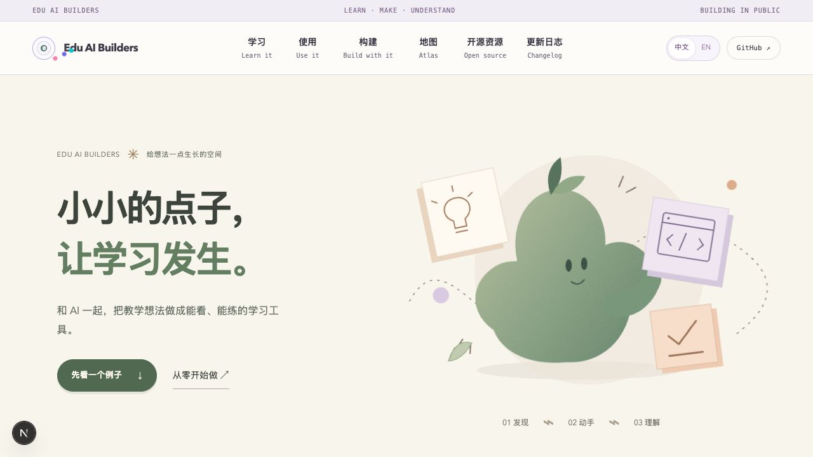
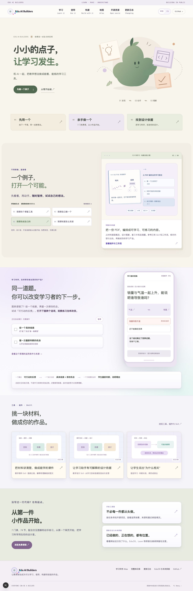
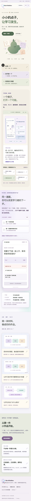
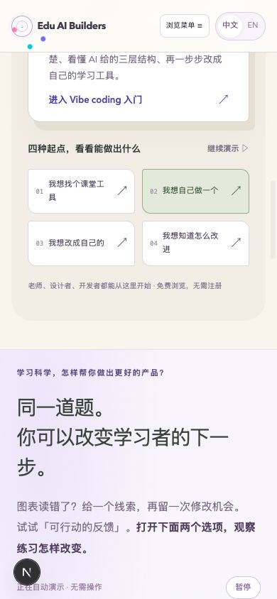
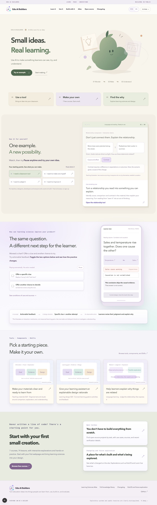

# 原站首页视觉更新 · 2026-10-10

已在 `apps/site-original/` 实现，可运行 `npm run dev -- --port 3100` 预览。当前预览 http://localhost:3100 。没有部署、push 或修改 GPT 预览、Radar、课程数据、SEO 专用文件。

## 视觉与信息结构

- 首屏从标题、双段说明、流程与多重说明，收敛到两行标题、一句用途、两个入口。
- 原创「种子伙伴」：苔绿渐层、颗粒表面、两片叶子；与杏色、薰衣草色纸片和铅笔轨迹组合。参考图只用于材质与空间关系启发，没有使用蓝色角色、nubo 名称或原图资产。
- 三张简短起点卡取代长篇人群说明，保留 `/use`、`/learn`、`/atlas` 路径。`/build`、`/directory`、`/changelog` 和现有四组示例、反馈实验继续可达。
- 示例区沿用已有交互，缩短首页说明；统一部分纸片圆角、柔和阴影和苔绿选中状态。首页其他模块减少标题与正文阅读负担。
- 插画为约 6 KB 内联 SVG，无外部图片请求、图片生成依赖或新客户端依赖。纹理限制在角色轮廓内。
- 纸片依次进入，连接轨迹显现一次，表达发现→动手→理解。无持续角色循环。`prefers-reduced-motion: reduce` 关闭新增动画与卡片位移；既有交互示例继续保留暂停与用户控制。
- 装饰插画从辅助技术树隐藏，标题、入口和流程标签保持真实文本，保留键盘焦点样式。中英文新文案均补齐。

## 修改文件

- `apps/site-original/app/components/home-opening.tsx`：原创 SVG、精简首屏、起点卡、中英文首屏。
- `apps/site-original/app/home-refresh.css`：本次首页样式与响应式、动画设置，独立覆盖旧样式。
- `apps/site-original/app/page.tsx`：引入新样式与首页短标题。
- `apps/site-original/app/components/home-experience.tsx`：精简首页示例与反馈实验说明，不改交互逻辑。
- `apps/site-original/app/i18n/common.en.json`：仅追加首页新增文本对应翻译；保留其他线程新增项。

## 验证

- `npm run build -- --webpack` 成功：编译、TypeScript、27 个页面生成完成。
- 默认 Turbopack 构建长时间停留编译阶段，手动停止本线程该进程，改用 Next.js 支持的 Webpack 构建参数通过；未修改项目构建配置。
- `npx tsc --noEmit` 成功。
- 修改的三个 TSX 文件 ESLint 成功；`git diff --check` 成功。
- 浏览器视觉检查：1280px 桌面与 390×844 手机。手机 `scrollWidth = innerWidth = 390`，没有水平溢出。首屏标题、操作入口、完整插画均可见。
- 浏览器点击「先看一个例子」到达 `#examples`；选择「我想自己做一个」成功切换到学习卡示例，并自动暂停。中文↔EN切换成功，新增首页文本在英文模式下显示英文。
- 全站翻译扫描仍报告其他线程修改中的 SEO 文件 6 项和 `/use/page.tsx` 1 项，本线程首页新增文案无缺项。此处未越权修改那些内容。
- 本地 `next dev` 自动生成 `apps/site-original/AGENTS.md`、`CLAUDE.md`，它们不是本次视觉交付源文件。

## 截图

## 补充：开源目录成为首页核心入口

本轮把首屏主 CTA 改为「逛开源目录」(`/directory`)，次入口「先试一个现成的」跳到紧接首屏起点卡的 `#open-source`。第一张起点卡也指向目录。新增 `app/components/home-open-source.tsx`，服务端只从现有 Radar snapshot 选取三个有效仓库记录，不修改目录数据、不向浏览器发送整个 catalog。

代表资源与真实入口（2026-10-10 查阅官方页面）：

| 资源 | 能做什么 | 主入口 | 源码 / 复用 |
| --- | --- | --- | --- |
| SymPy | 展开表达式、解方程 | [官方在线计算](https://live.sympy.org/) | 目录记录中的 GitHub / 官方入门教程 |
| Kolibri | 探索课程、练习、教师视角 | [官方演示](https://kolibridemo.learningequality.org/) | 目录记录中的 GitHub / 官方文档 |
| Easy Vibe | 跟着 AI 编程教程做原型 | [打开教程](https://datawhalechina.github.io/easy-vibe/) | 目录记录中的 GitHub / README |

SymPy Live 官方说明支持浏览器运行，无需安装。Kolibri 官方 about 页面明确链接 online demo，演示站重定向至 `/en/auth/`，可能需要选择演示身份；未声称免登录。Easy Vibe 是教程而非产品 demo，按钮明确标为「打开教程」。用途示意为轻量 CSS 图形，明确标注，非产品截图。每卡独立提供「源码」与「怎么用 / 复用」入口。

证据：[SymPy Live](https://live.sympy.org/)、[Kolibri 官方介绍与演示链接](https://learningequality.org/kolibri/about-kolibri/)、[Easy Vibe](https://datawhalechina.github.io/easy-vibe/)。

论文方向按用户确认的 arXiv 处理：预留「论文 → 一个能做的点子」轻量条带，标注规划中、优先复用开源聚合；只有实际可访问的 arXiv 搜索阅读链接，没有注册、订阅、成功状态。待目录线程完成聚合选型与试跑后，可将真实论文数据接入此处。

本轮验证：新增与修改 TSX 的 ESLint、Webpack 生产构建通过；TypeScript 与 `git diff --check` 通过。源码已核对三项官方入口、`#open-source` 和论文规划标识。本轮本地 server 启动被沙箱 EPERM 拒绝，未完成 HTTP 运行时检查。浏览器重新连接 localhost 被浏览器安全策略拒绝，停止该方式验证，没有改用其他浏览器规避。此前截图反映上一版本，本轮新增区块尚无新的视觉截图。桌面三列、手机单列样式已实现，最终视觉仍须浏览器恢复后复核。
